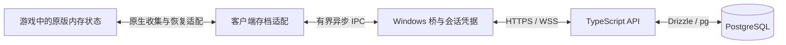

# 数据库存档与聊天：实验实现与后续边界

本机 WSL Ubuntu 的 PostgreSQL 18 已用于线上存储实验。服务端使用 Fastify、Zod、Drizzle、node-postgres 与 @fastify/jwt；服务端保持 TypeScript。数据库配置位于 server/config/，完整服务端配置按项目要求随仓库保存和自动部署，不依赖数据库配置 Secrets；不进入客户端包。

已实现用户名/密码注册、JWT 登录/注销、本人存档读取、revision CAS 写入和账号令牌版本失效。六张业务表的 id 均为 UUID 主键，用户名唯一；不建立 auth_sessions、rooms、room_members 表。聊天和照片仅有表结构，尚无可用接口/UI。

已实际验证：原生新角色 → HTTP → WSL PostgreSQL → 第二个游戏进程恢复。实验进程未打开 .save，现有 Saves 文件内容不变。这是开发实验，使用 Frida 进程内适配器；不是已发布的玩家客户端功能，也不证明照片、复杂剧情或双客户端联机已全部通过。

## 已确认的产品规则

- 独立角色、剧情、任务、NPC 状态、物品、个人天数；不统一房间日期。
- 房间只统一一天内的时间/时段。相同时间下，甲可以是第 3 天、乙是第 17 天。
- 保存由服务器按已认证账号归属，联机登录不再读取本机 AutoSave；单机保留原有存档路径。
- 游戏自带的 NPC 帖子与聊天属于个人剧情，玩家聊天室与私聊另建会话，不混用这些字段。
- users 长期保留。玩家聊天消息每天 UTC 00:00 物理删除前一日及更早的数据；存档内 NPC 剧情聊天不参加此清理。所有数据库连接使用 UTC。

当前实现仍会同步 day 并调用 AddDay 追赶，见 server/src/room.ts 和 mod/src/GameMod/network/calendar.ts；本次没有改动这一线上行为。迁移时必须同时更新客户端与服务端，不能只修改数据库。

## 逆向证据 → 发现 → 实施路径

| 证据                                                            | 发现                                                                                 | 实施路径                                                                               |
| --------------------------------------------------------------- | ------------------------------------------------------------------------------------ | -------------------------------------------------------------------------------------- |
| 当前游戏元数据、639 个运行时类型、原生方法地址和指令            | GetSave 先触发保存回调；LoadGame 从文件解密 JSON 后写入 _saveData；SaveGame 仍写文件 | 保留原版收集/恢复事务，在其存储边界适配数据库，先验证内存恢复入口                      |
| 4 个存档通过 HMAC/JSON 校验，联合 52 个顶层键和 186 条观察路径  | 根对象是动态字典；PlayFlag、任务、条件、NPC 和联系人属性可增键                       | player_saves.payload 保留完整 JSONB，已知结构校验，未知字段显式保留/隔离，不能静默删除 |
| PlayerData 有独立 day 与 timeOfDay；SetTime/AddDay 参与原版回调 | 时段与个人天数可以分离，但故事事务不能被房间时钟反复打断                             | 个人 day 留在存档；房间只广播周期标记和时段，原版剧情恢复时设安全屏障                  |
| PhotoData 非序列化 Unity 纹理、Photos/*.png 读图路径            | JSON 仅保存照片 flags/标识，图片不在 JSON 中                                         | 独立 save_assets 表保存图片，验证无盘下载、解码和生命周期                              |
| 当前账号仅是显示名，成员 ID 随连接重用                          | peerId 不能成为用户主键或私聊收件人                                                  | 增加持久 users UUID、鉴权和会话，再建立存档和聊天归属                                  |
| GameManager 的 Jint Hook 限制；当前桥为外部进程                 | 外部桥不能直接设置 Unity 的私有字段；现有接口没有已验证的无盘恢复入口                | 验证可调用的 JsonData/InitGame 路径，必要时扩展受控的原生适配层，不强行重写加载顺序    |

字段、原始结构、当前 RVA、二进制哈希与覆盖限制见 [存档字段](SAVE_FIELDS.md)。旧版偏移不可沿用。

## “不用本地存档”的目标边界

目标数据流：

数据库持久化与服务端裁决留在后端，客户端不直连数据库，不分发数据库密码。存档只发给本人，不走 room.send 广播。游戏场景、组件及 Unity 对象仍要在本机实例化；不代表把每帧位置、动画或 Unity 对象直接查询数据库。

必须先证明：登录拉取服务器快照 → 原版内存恢复与场景加载 → 任务/衣服/交互完成回调 → 开放游戏 → 原生快照上传 → 事务提交确认 → 客户端退出/重进恢复。全过程不读写 .save，照片也不能偷偷依赖本地旧文件。

当前 Mod 曾因跳过原版恢复顺序出现过角色/控制状态异常，因此不把“把 JSON 写入 SaveData 后调用 onLoadGame”当成已验证方案。需要检查新账号创建的原生默认值初始化，不能用另一玩家的存档当模板。

GameManager 在现有 Jint 表面不可直接注册 SaveGame/AutoSaving Hook；是否可通过原生 JsonData 与私有 InitGame 消息调用完成恢复，仍是原型待证项。若不行，需要增加最小受控的进程内适配能力；服务端不因此引入 .NET，现有外置桥也不会自动具备该能力。

## 房间时间与个人天数

建议房间时钟协议为 `{epoch, cycleSequence, timeOfDay, phaseElapsedMs, revision}`，不包含玩家 day。cycleSequence 是去重用的房间循环编号，不是所有人共用的日期。

| 场景                          | 规则                                                                                                      |
| ----------------------------- | --------------------------------------------------------------------------------------------------------- |
| 甲第 3 天、乙第 17 天同时在线 | 两人共享时段，个人天数分别保留                                                                            |
| 加入或重连                    | 对齐房间时段，当前循环作为基线；不因错过多个循环自动补天                                                  |
| 在线自然跨日或全员睡到次日    | 建议每人相对自己的日期加一天，即 4 / 18；保持差值                                                         |
| 个人剧情推进日期              | 只更新本人，不给整个房间加天                                                                              |
| 重复包、重启、迟到包          | epoch/revision/cycle 去重；个人天数与 player_saves.last_clock_epoch/last_clock_cycle 在同一数据库事务提交 |
| 剧情/过场/原版加载正在运行    | 暂停应用房间时间，等原版事务完成后安全对齐，不能每帧强制 SetTime                                          |

“自然跨日各自 +1、离线不补天”是待原型验收的建议语义。共享的是时钟阶段；剧情日期始终属于角色。

如果要精确到分钟，需先映射 GameTime、TimeOffset 和 timeOfDay 的计算与事件语义；目前不能宣称精确钟点同步已完成。不要直接把个人累计 GameTime 覆盖成服务器 Unix 时间。

剧情不同也意味着 NPC、任务触发和场景状态可能不同。建议只渲染同场景玩家，个人剧情切图不自动强制全房跟随；组队跟随作为显式功能。单靠数据库无法同时实现独立剧情和完全一致的 NPC/战斗/拾取世界，这需要另行定义玩法与权威。

## 数据表设计

初始化 SQL：[server/migrations/001_storage.sql](../server/migrations/001_storage.sql)。仅显式执行 --migrate 时应用；启动、构建和部署均不自动修改数据库，已有表时拒绝覆盖。

| 表                 | 作用                                                                                                                    |
| ------------------ | ----------------------------------------------------------------------------------------------------------------------- |
| users              | 稳定账号、登录名、显示名、密码摘要、状态与 auth_version                                                                 |
| player_saves       | 按 user/slot 保存完整 JSONB、格式/游戏版本、revision、个人时钟去重游标；personal_day 由 JSON 派生，避免两份日期互相覆盖 |
| save_assets        | 账号私有的照片图片，带归属 FK、大小限制和校验和；初期可用 BYTEA，运行时纹理不入库                                       |
| chat_conversations | 房间会话或两人私聊；私聊按排序后的用户 UUID 唯一，防止重复开会话                                                        |
| chat_members       | 会话成员、加入/离开、可见消息范围、已读游标                                                                             |
| chat_messages      | 正文、服务端时间、会话内序号、发送者和客户端幂等 ID                                                                     |

用户、存档、聊天是三个业务类别；物理上保留六张表，用于账号、个人存档/图片、聊天会话/成员/消息。房间时钟、在线成员和连接绑定由服务端内存维护，不建持久化表。没有为每个游戏字段机械建立一列，也没有把 NPC 联系人变成真实聊天成员。

存档正文是唯一原版状态来源，personal_day 仅为生成列。保存先校验 JWT、users.auth_version 与当前内存连接绑定，再通过 `WHERE id=? AND user_id=? AND revision=?` 做 CAS；更新 0 行返回 409，不能后到覆盖先到。单实例由 userId→connection 内存映射限制重复在线，不再使用数据库写租约。

### 不持久化会话与房间状态

登录成功时递增 users.auth_version，并用成熟 JWT 插件签发带 sub、版本和过期时间的短期令牌；退出或禁用账号使旧版本失效。不保存刷新会话，令牌到期重新登录。每次 HTTP 操作与 WS 消息都校验账号状态/版本；已建立的 WS 不能只在握手时检查。版本校验和存档写入应在同一事务/账号行锁下完成，避免旧连接与重新登录交错写入。

房间时钟、epoch、循环和在线名单存在进程内存。服务端重启后创建新的 epoch，玩家重新加入时建立时间基线，不补偿离线天数。player_saves 仅记录本人最后确认的时钟事件游标，与个人 day 原子保存；它不是持久化的房间表。

chat_conversations.room_key 是内存房间实例的 UUID，不是可重复使用的 public-1 名称，也不再有房间外键。新建或重建房间分配新 UUID，避免同名新房间继承旧聊天记录。聊天订阅/发送仍需校验实时内存成员与 chat_members 的可见范围；保留的聊天历史不代表玩家仍在线。

同账号一处在线由单实例内存连接映射处理，服务器重启后连接失效。该限制不是跨实例数据库约束；以后运行多个进程时，需要另行设计共享的连接仲裁。

数据库作为唯一来源不等于客户端可信：角色模拟仍在玩家电脑上，任意上传的金钱/任务变化不能因此自动成为防作弊权威。完整交易、战斗或任务校验是额外范围。

## API、中间件与聊天

建议使用 Fastify 的路由/JSON Schema、官方 JWT/限流插件、@fastify/websocket、Drizzle ORM 与 pg；沿用 Pino。使用成熟 HTTP/WS、数据库驱动和事务，不自行实现鉴权令牌、WebSocket 握手或 SQL 协议。PostgreSQL [JSONB](https://www.postgresql.org/docs/current/datatype-json.html) 适合保留完整结构；[Drizzle 事务](https://orm.drizzle.team/docs/transactions) 支持原子提交；[Fastify WebSocket](https://github.com/fastify/fastify-websocket) 可复用鉴权 Hook。

现有 TCP 可维持兼容期，但密码、令牌、私人存档和私聊必须通过 TLS 通道。不能把 auth/saves/chat 直接加进当前明文 room.send 白名单。

| API 草案                                               | 核心规则                                                     |
| ------------------------------------------------------ | ------------------------------------------------------------ |
| POST /auth/register、/auth/login、/auth/logout         | 框架鉴权、密码摘要、JWT 过期与 auth_version 校验，不记录凭据 |
| GET /me/save                                           | 根据当前会话取本人存档，不接受任意 userId                    |
| PUT /me/save                                           | 有界正文、版本验证、连接绑定、revision CAS，提交后返回新版本 |
| GET/PUT /me/save/assets/:photoName                     | 当前账号归属校验、图片长度/解码与摘要校验                    |
| GET /chat/conversations                                | 仅当前用户参与的会话                                         |
| POST /chat/direct/:userId                              | 服务端规范化两人会话，不信任客户端 senderId                  |
| GET /chat/conversations/:id/messages?afterSequence=... | 成员及可见范围校验、游标分页，禁止全表拉取                   |
| POST /chat/conversations/:id/messages                  | clientMessageId 幂等、正文限制、成员与限流校验               |
| WSS /events                                            | 鉴权后按成员订阅，断线按已提交序号补发                       |

聊天室离开后停止发言与实时订阅；默认不能读取加入前的房间历史。私聊只允许两名成员查询、订阅和发送；知道会话 UUID 不构成权限。已读游标必须验证边界并单调前进。

每个会话在消息事务里锁行并分配序号，插入成功提交后才 ACK/广播；客户端重试同一 clientMessageId 返回原消息；同一 ID 携带不同正文返回冲突。掉线后按最后确认序号补历史，不能用游戏日期当聊天排序时间。消息不属于 player_saves，不随个人剧情回档。Unity 聊天正文按纯文本显示或关闭 richText，不能把其他玩家正文当格式化标签执行。

当前所有 Jint→桥命令都写入 Player.log，不能传密码、访问令牌或完整私有存档。必须增加不泄漏正文的有界传输通道；至少凭据由桥持有，并采用受控原生 IPC 或浏览器授权，不能把秘密拼进日志命令。完整快照也不能直接塞进现有 64 KiB 房间帧或保留 128 个事件的状态列表。

当前 api/context.ts 的处理链是同步 void。数据库处理需有完整的 async/await 错误边界和队列，房间状态不能跨 await 失去顺序；不能仅在同步 Handler 中返回 Promise。存档和聊天用独立服务/事务，位置包继续用实时内存队列。

建议新增 api/auth.ts、api/saves.ts、api/chat.ts，middleware/auth.ts，services/saves.ts、services/chat.ts、services/clock.ts，以及 storage/db.ts 和 storage/schema.ts。既有传输、错误处理和限流可以复用，但鉴权、存档连接绑定和私聊成员检查必须独立。

PostgreSQL 是独立的运行服务；游戏后端仍可由 GitHub 打包为 Node.js SEA。新增依赖必须重新验证单文件打包和无 node_modules 的运行，不能假定所有插件都能自动封装。

## 实施顺序与放行条件

1. **无盘原型优先**：只在专用新角色/测试账号上验证数据库 JSON → 原版恢复 → 保存收集；禁止读取本地 AutoSave；确认角色、衣服、任务、联系人、NPC 和照片一致，且未产生 .save。失败时不替换当前客户端。
2. **拆开时间与天数**：移除房间绝对 day；测试不同个人日期、重连、重复包、睡眠、剧情过场与独立加天。
3. **账号与持久化**：加 TLS、JWT/账号版本校验、内存连接绑定、CAS、备份/恢复和断线处理；断网时停止写入与提示未保存，不能默默创建本地分叉存档。
4. **聊天室/私聊**：先做文本、成员权限、幂等和重连补历史，再做 UI/已读。复用手机 UI 容器，但与 NPC 剧情联系人隔离。
5. **联调与迁移**：旧本地档只可做显式一次性导入；是否开放导入属于产品选择。没有导入授权就为新账号原生初始化角色。版本化迁移，双实例与服务器重启验收后再发布。

若需求是“不依赖任何本地存档”，第一步必须先通过。先建库和聊天不会自动解决恢复入口的问题。

## 验证状态

- 真实 WSL PostgreSQL：用户名唯一、六表 UUID、错误密码/无效与过期 JWT、旧令牌失效、个人存档隔离、并发 revision 冲突、关闭重连后数据持久化。
- 游戏实验：两个独立进程，服务端把个人天数设置为 17 后再恢复，比较场景、外观与剧情集合；监控 .save 打开次数并比较原存档目录哈希。
- Mod 已删除 AutoSave/LoadSaveWindow 读取入口和本地槽位选择；缺少线上适配器时拒绝进入。床边保存仅请求内存快照，提示排队，不假报数据库提交成功。
- 仍需完成：正式客户端集成/分发、照片字节恢复、复杂剧情/任务和双客户端验收、房间时钟去掉共享 day、聊天室/私聊 API 与 UI。
- 本机实验不会部署到 13.40.7.1，也未推送或重新发布玩家 ZIP。使用方式见 [线上存储实验](ONLINE_STORAGE.md)。
